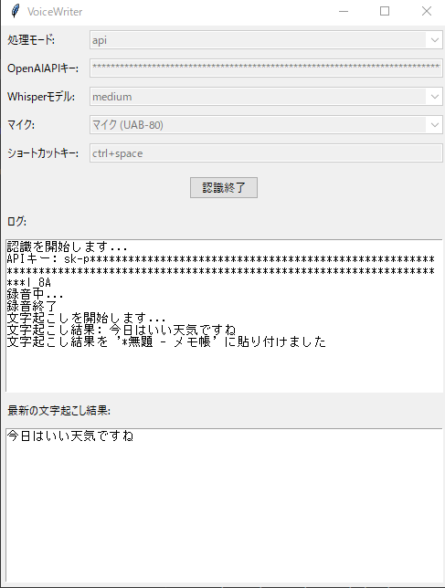

# VoiceWriter

VoiceWriterは、ショートカットキーを押している間の音声を文字起こしし、クリップボード経由でアクティブなウィンドウへ貼り付けるPythonアプリケーションです。



## 特徴

- ショートカットキーを押している間だけ録音する（プッシュ・トゥ・トーク）
- OpenAI Whisperモデル（ローカル実行）またはOpenAI APIによる文字起こし
- カスタマイズ可能なショートカットキー
- 複数の処理モード（API、CPU、CUDA）をサポート
- 録音・文字起こし中も操作できるGUI

## 動作環境

- **Windows 10 / 11**（キー監視と貼り付けはWindowsを前提にしています）
- **Python 3.10 〜 3.13**（Tkinterを含むもの。python.org版のインストーラーには同梱されています）
- マイク
- CUDAモード: NVIDIA GPUと、CUDA対応ビルドのPyTorch
- APIモード: OpenAI APIキー

Python 3.14以降は、PyAudioのWindows用ビルド済みパッケージが配布されていないため対象外です（PyAudio 0.2.14時点）。

macOS / Linuxは動作対象外です。キー監視に使う`keyboard`ライブラリが管理者権限を要求し、macOSでは読み込み時にプロセスが異常終了する環境があります（その場合は起動時にエラーを表示して終了します）。

## インストール

1. リポジトリをクローンまたはダウンロードします。
2. 仮想環境を作成し、必要なライブラリをインストールします：
   ```
   python -m venv venv
   venv\Scripts\activate
   pip install -r requirements.txt
   ```
3. CUDAモードを使う場合は、PyTorchをCUDA対応ビルドに入れ替えます。`pip install -r requirements.txt`で入るWindows用のPyTorchはCPU版です。GPUとドライバーに合うコマンドを[PyTorch公式の案内](https://pytorch.org/get-started/locally/)で確認してください。
   ```
   pip uninstall -y torch
   pip install torch --index-url https://download.pytorch.org/whl/cu130
   ```
   `cu130`は例です。

## 使用方法

1. `main.py`を実行します：
   ```
   python main.py
   ```
2. GUIで設定を行います：
   - 処理モードを選択（api、cpu、cuda）
   - APIキーを入力（apiモードの場合。空欄のときは環境変数`OPENAI_API_KEY`を使います）
   - Whisperモデルを選択（cpuまたはcudaモードの場合）
   - マイクを選択
   - ショートカットキーを設定（例: `ctrl+space`、`f9`）
3. 「認識開始」ボタンをクリックします。cpu / cudaモードでは、ログに「モデルのロードが完了しました。」と表示されてから録音できます（初回はモデルのダウンロードが入ります）。
4. 設定したショートカットキーを押しながら話し、話し終えたらキーを離します。
5. 変換されたテキストは自動的にクリップボードにコピーされ、アクティブなウィンドウに`Ctrl+V`で貼り付けられます。
6. 「認識終了」ボタンで停止します。実行中の文字起こしがある場合は、その完了を待ってから停止します。「認識終了」を押した後に完了した文字起こしは貼り付けません（押した時点で貼り付けの途中だった1件は、最後まで貼り付けます）。

### 録音の上限

文字起こしが録音に追いつかない場合にメモリを使い続けないよう、上限を設けています（`config.py`の`MAX_RECORDING_SECONDS` / `MAX_PENDING_RECORDINGS`）。

- キーを押し続けた録音は5分ごとに区切って文字起こしし、録音は続けます。区切ったことはログに表示します。
- 文字起こし待ちの録音は4件までです。上限に達している間はキーを押しても録音せず、その理由をログに表示します。処理が進んでから押し直してください。

### 処理モードとモデル

| モード | 処理場所 | 補足 |
| --- | --- | --- |
| api | OpenAI API（`whisper-1`） | 録音した音声をOpenAIへ送信します。利用料金が発生します |
| cpu | このPCのCPU | 音声は外部へ送信されません |
| cuda | このPCのNVIDIA GPU | CUDAを利用できない場合は、ログに表示したうえでCPUで処理します |

Whisperモデルは`tiny` / `base` / `small` / `medium` / `large` / `turbo`から選べます。大きいモデルほど精度が高く、読み込みと処理に時間とメモリを使います。

## 設定

設定はJSONファイル（`voicewriter_config.json`）に保存され、アプリケーション終了時に自動的に更新されます。保存先は起動時のカレントディレクトリです。

- **APIキーも平文で保存されます。** 保存したくない場合は入力欄を空のままにして、環境変数`OPENAI_API_KEY`を設定してください。
- 設定ファイルが壊れていて読めない場合は、`voicewriter_config.json.broken`に退避し、既定値で起動します。退避が既にある場合は上書きせず、`.broken.1`、`.broken.2`…と別名で残します。

## うまく動かないとき

ログ欄に理由が表示され、設定を直して「認識開始」をやり直せます。

| 表示・症状 | 対処 |
| --- | --- |
| `認識を開始できません: マイクが選択されていません。` | マイクを選択します。一覧は起動時に取得するため、後から接続したマイクはアプリを再起動すると表示されます |
| `認識を開始できません: ショートカットキー '...' を解釈できません` | `ctrl+space`のように、キー名を`+`でつないで入力します |
| `認識を開始できません: APIキーが入力されていません` | APIキーを入力するか、環境変数`OPENAI_API_KEY`を設定します |
| `エラーが発生しました: ...`（文字起こしの失敗） | APIキー・通信状態を確認します。認識は継続しているので、そのまま録音し直せます |
| `エラーが発生したため認識を終了しました: ...` | マイクの接続やモデル名を確認し、「認識開始」をやり直します |
| `CUDAを利用できないため、CPUで処理します。` | PyTorchがCPU版です。インストールの手順3を確認します |
| `文字起こし待ちの録音が上限（4件）に達しているため、録音できません。` | 文字起こしが録音に追いついていません。処理が進んでから押し直します。続く場合は小さいモデルかcuda / apiモードを使います |

## 開発

テストとlintは、音声機器・Whisper・OpenAI APIを使わずに実行できます（テスト内で差し替えています）。

```
pip install -r requirements-dev.txt
ruff check .
pytest
```

製品の依存がWindowsで導入・importできることは、次の手順で確かめます（マイク・キー入力・API・モデルのダウンロードは使いません）。

```
pip install -r requirements.txt
pip check
python -c "import keyboard, numpy, openai, pyaudio, pyautogui, pyperclip, torch, whisper; import main"
```

GitHub Actions（`.github/workflows/ci.yml`）は、Windows上のPython 3.10 / 3.12 / 3.13で上の2つを別々のジョブ（`test` / `install`）として実行します。

| ファイル | 役割 |
| --- | --- |
| `main.py` | 起動と部品の組み立て |
| `gui.py` | 画面。ワーカースレッドからのイベントをメインスレッドで反映する |
| `recognition.py` | 録音・文字起こし・貼り付けをGUIスレッドの外で実行する認識セッション |
| `audio_processor.py` | マイクの一覧とPyAudioストリーム |
| `transcription_processor.py` | OpenAI API / ローカルWhisperによる文字起こし |
| `hotkey.py` | ショートカットキーの検証と押下判定 |
| `text_output.py` | クリップボードへのコピーと貼り付け |
| `utils.py` / `config.py` | 設定ファイルの読み書き / 定数 |

## 注意事項

- 認識中はマイクを開いたままにします。
- 貼り付けはクリップボードを上書きします。
- APIモードを使用する場合は、有効なOpenAI APIキーが必要です。
